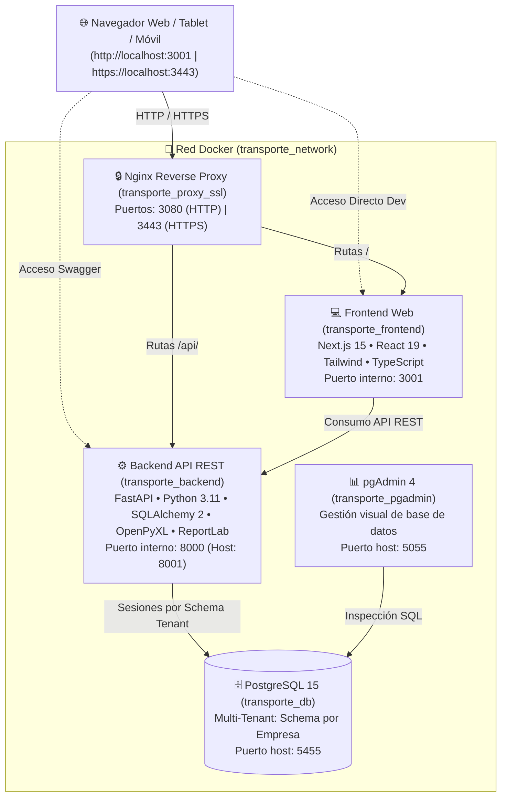
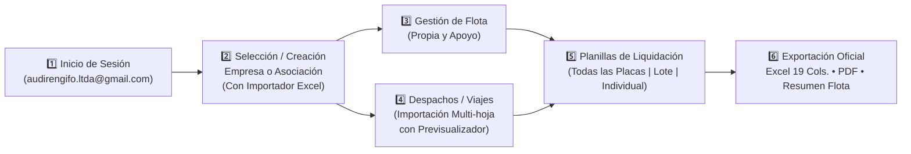

# 🚛 Sistema Multi-Tenant de Liquidación de Empresas de Transporte y Asociaciones
### Rengifo Ltda. &bull; Transporte Internacional de Hidrocarburos y Carga Líquida

[](https://www.docker.com/)
[](https://nextjs.org/)
[](https://fastapi.tiangolo.com/)
[](https://www.postgresql.org/)
[](https://www.typescriptlang.org/)
[](https://www.python.org/)
[](https://tailwindcss.com/)
[](https://nginx.org/)

---

## 📋 Tabla de Contenidos

1. [¿Para qué sirve el sistema?](#-para-qué-sirve-el-sistema)
2. [Características Principales](#-características-principales)
3. [Arquitectura del Sistema](#-arquitectura-del-sistema)
4. [Puertos, Red y Enlaces de Acceso](#-puertos-red-y-enlaces-de-acceso)
5. [Credenciales de Acceso por Defecto](#-credenciales-de-acceso-por-defecto)
6. [Requisitos Previos del Entorno](#-requisitos-previos-del-entorno)
7. [Guía de Despliegue Rápido con Docker (Recomendado)](#-guía-de-despliegue-rápido-con-docker-recomendado)
8. [Despliegue Manual para Desarrollo (Bare-Metal)](#-despliegue-manual-para-desarrollo-bare-metal)
9. [Flujo Operativo del Sistema (Paso a Paso)](#-flujo-operativo-del-sistema-paso-a-paso)
10. [Mantenimiento, Respaldo y Restauración](#-mantenimiento-respaldo-y-restauración)
11. [Estructura del Repositorio](#-estructura-del-repositorio)
12. [Preguntas Frecuentes y Solución de Problemas](#-preguntas-frecuentes-y-solución-de-problemas)
13. [Licencia y Soporte](#-licencia-y-soporte)

---

## 🎯 ¿Para qué sirve el sistema?

El **Sistema de Liquidación de Empresas de Transporte - Rengifo Ltda.** es una plataforma integral de gestión logística, auditoría operativa y liquidación financiera desarrollada a medida para empresas y asociaciones de transporte terrestre de hidrocarburos y carga líquida (Diésel Oil, Gasolina Especial, Insumos y Aditivos, Petróleo Crudo) que prestan servicios a **Yacimientos Petrolíferos Fiscales Bolivianos (YPFB)** y clientes privados internacionales.

### 📌 Problemáticas que resuelve:
1. **Conciliación Volumétrica y Control de Mermas**: Monitorea automáticamente las diferencias entre el volumen cargado en origen (refinerías/puertos como Arica, Iquique, Mejillones) y el volumen efectivamente recepcionado en plantas de destino (Senkata, Palmasola, Oruro). Aplica de forma automática las tolerancias normativas contractuales (0.15% Diésel, 0.25% Gasolina, 0.20% IYA) deduciendo el exceso a precios de merma oficiales (ej. 7.45 Bs/L).
2. **Determinación del Líquido Pagable Oficial (Ley 843 Art. 4)**: Calcula con exactitud matemática el flete total bruto y aplica deductivos normativos contractuales:
   - Retención de Garantía YPFB BOL-GART (7%).
   - Comisión de retención administrativa / transporte (7%).
   - Comisión en dólares por metro cúbico ($1.00 USD/m³ convertido al tipo de cambio oficial).
   - Comisión de intermediación logística (3%).
   - Costos fijos operativos (Hojas de Ruta de Tránsito y Monitoreo Satelital GPS).
   - Anticipos y otros descuentos configurables.
3. **Multi-Tenancy con Aislamiento Total**: Permite administrar múltiples empresas transportistas bajo una misma infraestructura, o agruparlas en **Asociaciones de Transporte**. Cada empresa cuenta con un esquema de base de datos PostgreSQL independiente (`tenant.schema_name`), garantizando que la información financiera y operativa esté 100% aislada y segura.
4. **Emisión de Planillas Oficiales de Liquidación (Hojas 1 y 2)**: Genera de forma idéntica las planillas oficiales de auditoría requeridas para facturación y cobro:
   - **Hoja 1 (Pág. 2)**: Cuadro de 19 columnas con desglose viaje por viaje (MCI/DTA, CRT, fechas de carga/descarga, tramo, cliente, volúmenes, mermas, tarifas y fletes).
   - **Hoja 2 (Pág. 3)**: Cuadro consolidado de descuentos normativos, determinación del Líquido Pagable en Bs. y firmas de auditoría legal (Elaborado, Revisado, Autorizado y Cancelado).
5. **Auditoría de Flota en Tiempo Real**: Matriz de validación por cisterna con opción de **"Todas las Placas"**, que permite visualizar el estado de conciliación de toda la flota en cualquier período (mensual, semestral, anual o personalizado) y liquidar en lote con un solo clic.

---

## ✨ Características Principales

```
┌────────────────────────────────────────────────────────────────────────┐
│                   CAPACIDADES DEL SISTEMA RENGIFO LTDA                 │
├────────────────────────────────┬───────────────────────────────────────┤
│ 🏢 Arquitectura Multi-Tenant   │ Esquema PostgreSQL dedicado por       │
│    y Asociaciones              │ empresa + Agrupación en Asociaciones  │
├────────────────────────────────┼───────────────────────────────────────┤
│ 📊 Importación Masiva Excel    │ Asistente multi-hoja (2024, 2025...)   │
│    con Previsualizador         │ Previsualización y edición en vivo    │
├────────────────────────────────┼───────────────────────────────────────┤
│ 🚛 Matriz Flota "Todas Placas" │ Validación por cisterna, fletes,      │
│    y Liquidación en Lote       │ mermas y liquidación masiva en 1 clic │
├────────────────────────────────┼───────────────────────────────────────┤
│ 📑 Planillas Oficiales Hojas   │ Reproducción fiel de Hojas 1 y 2      │
│    1 y 2 (Excel y PDF)         │ Fórmulas contables y firmas legales   │
├────────────────────────────────┼───────────────────────────────────────┤
│ ⚙️ Panel de Parámetros         │ Tolerancias de merma, comisiones,     │
│    y Firmas de Auditoría       │ tipo de cambio y firmantes oficiales  │
├────────────────────────────────┼───────────────────────────────────────┤
│ 🌓 Soporte Claro / Oscuro      │ Interfaz adaptativa con SweetAlert2   │
│    y Notificaciones Vivas      │ contextuales, diagnósticos y guía     │
└────────────────────────────────┴───────────────────────────────────────┘
```

- **Asistente Inteligente de Importación Excel**:
  - Lee libros de cálculo complejos con múltiples pestañas/hojas por año (ej. pestañas `2024`, `2025`, `2026`).
  - Detección automática y mapeo inteligente de columnas logísticas (fechas, placas, tramos, volúmenes, mermas, facturas, clientes).
  - **Previsualizador Interactivo**: Antes de guardar en base de datos, el usuario puede inspeccionar los datos, corregir celdas vacías en vivo, eliminar filas no deseadas o validar la importación sin bloqueos por duplicados legítimos.
  - El asistente está disponible en la creación de Empresas, creación de Asociaciones y en el módulo de Despachos.
- **Módulo de Liquidaciones Avanzado**:
  - Filtro unificado de períodos: **Mensual**, **Semestral** (S1/S2), **Anual** y **Rango Personalizado**.
  - Selector de Placa con opción destacada `📋 Todas las Placas (Consolidado General)`.
  - Matriz de Validación de Flota: muestra para cada cisterna su tipo de unidad (**Propia** vs **Apoyo**), viajes, volúmenes, flete bruto, descuentos, líquido pagable y estado (Liquidada vs Pendiente).
  - Botón de acción **"Liquidar Toda la Flota"**: procesa y guarda simultáneamente las liquidaciones individuales de todas las cisternas con viajes en el período.
  - Exportación de **Resumen de Flota en Excel**: hoja ejecutiva de auditoría con totales acumulados y firmas.
  - Exportaciones dinámicas con ID 0 para visualizar o exportar cálculos en vivo sin requerir guardado previo.
- **Flota Propia y Flota de Apoyo**:
  - Control de cisternas propias y unidades externas aliadas de apoyo.
  - Registro de capacidades en litros y m³, número de compartimentos, conductores, propietarios y vigencia documental (SOAT, B-SISA, SENASAC, Inspección Técnica).
- **Seguridad y Acceso Multidispositivo**:
  - Proxy seguro **Nginx con SSL/TLS** integrado.
  - Accesible localmente y a través de la red local Wi-Fi/LAN desde teléfonos, tablets y laptops.
  - Autenticación JWT con roles diferenciados (`admin`, `user`).

---

## 🏛️ Arquitectura del Sistema

El sistema implementa una arquitectura desacoplada basada en microservicios contenerizados mediante Docker:



### Esquema de Datos Multi-Tenant en PostgreSQL:
- **Esquema `public`**: Tablas compartidas del sistema: `users` (credenciales y roles), `asociaciones` (agrupaciones), `empresas` (registro de empresas y vinculación con su `schema_name`).
- **Esquema `tenant` (`empresa_<nombre>`)**: Tablas aisladas por cada empresa:
  - `unidades_transporte`: Flota propia de camiones/cisternas.
  - `empresas_apoyo` y `unidades_apoyo`: Flota de apoyo y transportistas aliados.
  - `clientes`: Clientes consignatarios (YPFB, etc.).
  - `viajes`: Despachos operativos con datos de origen, destino, volumen, facturación y mermas.
  - `liquidaciones`: Planillas de liquidación oficiales emitidas con firmas y montos netos.
  - `parametros_liquidacion`: Tolerancias, tarifas, comisiones y configuración legal de la empresa.

---

## 🔌 Puertos, Red y Enlaces de Acceso

Para garantizar la convivencia sin conflictos con otros servidores o proyectos locales (como servicios en puertos 80, 443, 3000, 8000, 8080 o 5432), el sistema utiliza puertos dedicados no colisionantes:

| Servicio | Puerto Host | Enlace Local | Enlace en Red Local (LAN / Wi-Fi) | Protocolo / Propósito |
| :--- | :---: | :--- | :--- | :--- |
| **Frontend Web** | `3001` | [http://localhost:3001](http://localhost:3001) | `http://<IP_LOCAL>:3001` | Interfaz Web Principal Next.js 15 |
| **Proxy SSL (HTTPS)** | `3443` | [https://localhost:3443](https://localhost:3443) | `https://<IP_LOCAL>:3443` | Acceso Seguro Nginx SSL/TLS |
| **Proxy HTTP** | `3080` | [http://localhost:3080](http://localhost:3080) | `http://<IP_LOCAL>:3080` | Redirección segura a HTTPS |
| **Backend API (Docs)** | `8001` | [http://localhost:8001/api/docs](http://localhost:8001/api/docs) | `http://<IP_LOCAL>:8001/api/docs` | Documentación interactiva Swagger UI |
| **Base de Datos** | `5455` | `localhost:5455` | `<IP_LOCAL>:5455` | Motor PostgreSQL 15 (`db_transporte_liquidacion`) |
| **pgAdmin 4** | `5055` | [http://localhost:5055](http://localhost:5055) | `http://<IP_LOCAL>:5055` | Administrador Visual de Base de Datos |

> [!TIP]
> **Acceso desde celulares, tablets u otras PCs de la empresa**:
> Identifica la dirección IP de tu servidor ejecutando `ipconfig` en Windows (o `ip a` en Linux). Podrás ingresar desde cualquier dispositivo conectado a la misma red Wi-Fi o cableada abriendo:
> `http://<TU_IP_LOCAL>:3001` (por ejemplo: `http://192.168.0.24:3001`).

---

## 🔑 Credenciales de Acceso por Defecto

Al inicializar el sistema con Docker, el script `seed_data.py` auto-inicializa las credenciales maestras y usuarios necesarios:

### 1. Usuarios del Sistema Web
| Rol | Usuario / Correo | Contraseña | Permisos |
| :--- | :--- | :--- | :--- |
| **Administrador Oficial Rengifo** | `audirengifo.ltda@gmail.com` | `liquidaciones26` | Acceso total a todas las asociaciones, empresas, configuraciones y auditorías |
| **Administrador de Respaldo** | `admin` | `admin123` | Acceso administrativo general |
| **Operador de Liquidaciones** | `usuario` | `user123` | Gestión operativa de viajes y cálculo de planillas |

### 2. Credenciales de Base de Datos y pgAdmin
| Componente | Usuario / Email | Contraseña | Base de Datos | Puerto |
| :--- | :--- | :--- | :--- | :---: |
| **PostgreSQL 15** | `admin_transporte` | `transporte_seguro_2026` | `db_transporte_liquidacion` | `5455` |
| **pgAdmin 4** | `admin@transporte.com` | `transporte_seguro_2026` | Conectar al host `db` (puerto `5432`) | `5055` |

---

## 💻 Requisitos Previos del Entorno

### Requisitos Mínimos de Hardware
- **Procesador**: 2 núcleos (x86_64 / ARM64).
- **Memoria RAM**: 4 GB (se recomiendan 8 GB o superior para despliegue de todos los contenedores).
- **Espacio en Disco**: 5 GB de espacio libre disponible.

### Requisitos de Software
- **Docker Desktop** (en Windows/macOS) o **Docker Engine + Docker Compose Plugin v2** (en Linux).
- **Git** instalado en el sistema.
- Puertos libres en el host: `3001`, `8001`, `5455`, `5055`, `3080` y `3443`.

---

## 🚀 Guía de Despliegue Rápido con Docker (Recomendado)

El método oficial y recomendado es utilizar **Docker Compose**, el cual construye y orquesta automáticamente el Frontend, Backend, Base de Datos, pgAdmin y Nginx con un único comando.

### Paso 1: Clonar el Repositorio
Abre tu terminal o PowerShell y ejecuta:
```bash
git clone https://github.com/rodaltamir/sistema_de_liquidacion_de_transporte-rengifo-ltda.git
cd sistema_de_liquidacion_de_empresas_de_transporte-rengifoltda
```

### Paso 2: Iniciar los Contenedores
Ejecuta la construcción y arranque en segundo plano (`-d`):
```bash
docker compose up -d --build
```

El proceso realizará automáticamente:
1. Creación de la red interna `transporte_network` y el volumen persistente `transporte_pgdata`.
2. Lanzamiento del contenedor `transporte_db` (PostgreSQL 15) con comprobación de estado de salud (`healthcheck`).
3. Construcción del backend FastAPI (`transporte_backend`) y ejecución automática de `seed_data.py` (creación de tablas públicas y usuario administrador).
4. Compilación del frontend Next.js 15 (`transporte_frontend`) en modo optimizado de producción.
5. Puesta en marcha de pgAdmin 4 (`transporte_pgadmin`) y Nginx SSL (`transporte_proxy_ssl`).

### Paso 3: Verificar el Estado de los Contenedores
Comprueba que todos los contenedores estén activos (`Up`):
```bash
docker compose ps
```

Deberás ver una salida similar a la siguiente:
```
NAME                   IMAGE                                               STATUS         PORTS
transporte_db          postgres:15-alpine                                  Up (healthy)   0.0.0.0:5455->5432/tcp
transporte_backend     sistema_de_liquidacion_...-backend                 Up             0.0.0.0:8001->8000/tcp
transporte_frontend    sistema_de_liquidacion_...-frontend                Up             0.0.0.0:3001->3001/tcp
transporte_pgadmin     dpage/pgadmin4                                      Up             0.0.0.0:5055->80/tcp
transporte_proxy_ssl   nginx:alpine                                        Up             0.0.0.0:3080->80/tcp, 0.0.0.0:3443->443/tcp
```

### Paso 4: Abrir la Aplicación
Abre tu navegador web favorito e ingresa a:
👉 **[http://localhost:3001](http://localhost:3001)** (o [https://localhost:3443](https://localhost:3443))

Inicia sesión con:
- **Correo**: `audirengifo.ltda@gmail.com`
- **Contraseña**: `liquidaciones26`

---

## 🛠️ Despliegue Manual para Desarrollo (Bare-Metal)

Si deseas modificar el código en caliente sin utilizar contenedores para el código fuente:

### 1. Base de Datos (PostgreSQL)
Puedes iniciar únicamente el contenedor de base de datos con:
```bash
docker compose up -d db
```
O conectar tu propia instancia local de PostgreSQL en el puerto `5455` (o `5432`) creando la base de datos `db_transporte_liquidacion`.

### 2. Configurar y Ejecutar el Backend (FastAPI)
```bash
cd backend

# Crear y activar entorno virtual
python -m venv venv
# En Windows:
venv\Scripts\activate
# En Linux/macOS:
source venv/bin/activate

# Instalar dependencias
pip install -r requirements.txt

# Inicializar estructura y usuario administrador
python seed_data.py

# Iniciar servidor de desarrollo en puerto 8001
uvicorn main:app --host 0.0.0.0 --port 8001 --reload
```
La documentación de la API quedará accesible en [http://localhost:8001/api/docs](http://localhost:8001/api/docs).

### 3. Configurar y Ejecutar el Frontend (Next.js)
En otra terminal:
```bash
cd frontend

# Instalar paquetes npm
npm install

# Iniciar servidor de desarrollo en puerto 3001
npm run dev
```
El frontend quedará activo en [http://localhost:3001](http://localhost:3001).

---

## 🔄 Flujo Operativo del Sistema (Paso a Paso)



### 1. Selección o Creación de Empresa / Asociación
- Al iniciar sesión, el sistema presenta la pantalla de **Seleccionar Empresa** o **Seleccionar Asociación**.
- **Creación Asistida**: Puedes crear una empresa nueva e importar directamente en el formulario su archivo Excel histórico de despachos. Si el archivo cuenta con hojas por años (`2024`, `2025`, `2026`), el sistema las consolida en un solo paso.
- Si gestionas una **Asociación**, puedes agrupar varias empresas bajo una misma personería jurídica para consultar fletes consolidados.

### 2. Configuración de Parámetros de Liquidación
- Ingresa al menú **Configuración** (`/[schema]/configuracion`) de la empresa.
- Define las tolerancias contractuales oficiales:
  - Tolerancia Merma Diésel: `0.15%`.
  - Tolerancia Merma Gasolina: `0.25%`.
  - Tolerancia Merma IYA: `0.20%`.
  - Precio de Merma de Referencia: `7.45 Bs/Litro`.
  - Tipo de Cambio: `6.96 Bs/USD`.
- Configura las comisiones y costos de monitoreo (Comisión 1 $us/m³, 7% YPFB BOL-GART, Hojas de Ruta, GPS).
- Registra los nombres y cargos de los firmantes oficiales de auditoría (Elaborado por, Revisado por, Autorizado por, Cancelado por).

### 3. Registro e Importación de Despachos (Viajes)
- Ingresa a **Viajes / Despachos** (`/[schema]/viajes`).
- Puedes registrar despachos individualmente con las 17-19 columnas normativas o hacer clic en **"Importar Despachos (Excel)"**:
  1. Selecciona tu archivo `.xlsx` o `.xls`.
  2. Si el libro tiene varias hojas, el asistente procesará las hojas de años seleccionadas.
  3. Se abre el **Modal de Previsualización Interactivo**:
     - Indica cuántos despachos válidos se detectaron y si hay datos incompletos.
     - Puedes corregir campos vacíos directamente haciendo clic en las celdas de la tabla.
     - Permite descartar filas antes de la importación definitiva.
  4. Haz clic en **"Confirmar e Importar Despachos"**. Los viajes se registrarán automáticamente con estado `Pendiente`.

### 4. Flota Propia y Flota de Apoyo
- En el módulo **Flota** (`/[schema]/flota`), revisa los camiones propios registrados, conductores y documentación.
- En el módulo **Flota de Apoyo** (`/[schema]/apoyo`), gestiona las empresas transportistas aliadas y cisternas externas que complementan la capacidad operativa de la empresa.

### 5. Planillas de Liquidación (Individual, Lote y Consolidado)
- Ingresa a **Liquidaciones** (`/[schema]/liquidaciones`).
- Selecciona el período en el filtro superior: **Mensual**, **Semestral**, **Anual** o **Rango Personalizado**.
- **Opciones de Visualización**:
  - **Todas las Placas (Consolidado General)**:
    - Activa la **Matriz de Validación por Cisterna**, donde visualizas el flete bruto, deducciones, líquido pagable y estado de liquidación de cada cisterna.
    - Utiliza el buscador rápido para filtrar por placa o conductor.
    - Haz clic en **"Liquidar Toda la Flota"** para generar y guardar las liquidaciones de todos los camiones activos en lote.
    - Haz clic en **"Ver Planilla"** en cualquier cisterna para inspeccionar al instante su planilla de 19 columnas.
    - Alterna a la pestaña **"Planilla Consolidada"** para ver las Hojas 1 y 2 con todos los viajes acumulados de la flota.
  - **Cisterna Individual**:
    - Selecciona una placa específica del listado para generar o inspeccionar su planilla oficial.
    - Haz clic en **"Ajustar deducciones"** si necesitas aplicar descuentos manuales extraordinarios.

### 6. Exportación y Entrega Oficial
- **Descargar Excel**: Genera el libro `.xlsx` oficial con el formato exacto de auditoría de 19 columnas, tramos, facturación, mermas, resumen de descuentos y firmas legales.
- **Descargar PDF**: Emite el documento en PDF de alta fidelidad listo para impresión oficial o remisión digital.
- **Resumen Flota Excel**: Desde la vista de *Todas las Placas*, descarga la planilla consolidada ejecutiva de toda la flota.

---

## 🧰 Mantenimiento, Respaldo y Restauración

### Ver Registros en Tiempo Real (Logs)
```bash
# Ver logs de todos los servicios
docker compose logs -f

# Ver logs únicamente del backend
docker compose logs -f backend

# Ver logs únicamente del frontend
docker compose logs -f frontend
```

### Reiniciar Servicios
```bash
# Reiniciar backend
docker compose restart backend

# Reiniciar frontend
docker compose restart frontend
```

### Reconstruir el Frontend tras Cambios en Código
Dado que el contenedor de frontend compila Next.js en modo producción para máximo rendimiento:
```bash
docker compose build frontend
docker compose up -d --no-deps frontend
```

### Limpieza y Reinicio de Base de Datos
Si deseas purgar los datos demo o restablecer el sistema en blanco manteniendo únicamente el usuario administrador:
```bash
docker exec -it transporte_backend python seed_data.py --clean
```

### Respaldo de Base de Datos (Backup)
Para generar una copia de seguridad completa de todos los esquemas (públicos y tenants):
```bash
# En Windows (PowerShell) o Linux:
docker exec -t transporte_db pg_dump -U admin_transporte -d db_transporte_liquidacion -F c > backup_transporte_$(Get-Date -Format 'yyyyMMdd_HHmmss').dump
```

### Restauración de Base de Datos (Restore)
Para restaurar una copia de seguridad:
```bash
docker exec -i transporte_db pg_restore -U admin_transporte -d db_transporte_liquidacion --clean --if-exists < backup_transporte.dump
```

---

## 📂 Estructura del Repositorio

```text
sistema_de_liquidacion_de_empresas_de_transporte-rengifoltda/
├── backend/                               # Servicio API REST (FastAPI)
│   ├── app/
│   │   ├── api/                           # Controladores y Endpoints REST
│   │   │   ├── auth.py                    # Login, JWT y perfiles
│   │   │   ├── empresas.py                # CRUD de Empresas y Esquemas Tenant
│   │   │   ├── asociaciones.py            # CRUD y métricas de Asociaciones
│   │   │   ├── viajes.py                  # Despachos, importación Excel e inspección
│   │   │   ├── liquidaciones.py           # Planillas, lote, Todas las Placas, export
│   │   │   ├── unidades.py                # Flota propia
│   │   │   ├── unidades_apoyo.py          # Flota de apoyo y transportistas aliados
│   │   │   └── configuracion.py           # Parámetros y firmas de auditoría
│   │   ├── core/                          # Seguridad, JWT y Settings
│   │   ├── db/                            # Sesiones SQLAlchemy y Multi-Tenant Engine
│   │   ├── models/                        # Modelos ORM (public.py y tenant.py)
│   │   ├── schemas/                       # Validación de datos con Pydantic v2
│   │   └── services/                      # Motores de cálculo y exportación
│   │       ├── calculation_engine.py      # Algoritmo de fletes y mermas Ley 843
│   │       ├── excel_export.py            # Generador OpenPyXL multihoja oficial
│   │       ├── pdf_export.py              # Generador ReportLab con firmas
│   │       └── excel_import_service.py    # Asistente multi-hoja de importación
│   ├── exports/                           # Directorio temporal de archivos generados
│   ├── Dockerfile                         # Dockerfile optimizado Python 3.11
│   ├── main.py                            # Punto de entrada FastAPI y CORS
│   ├── seed_data.py                       # Inicialización y sembrado de usuarios
│   └── requirements.txt                   # Dependencias Python
├── frontend/                              # Servicio Web (Next.js 15 App Router)
│   ├── src/
│   │   ├── app/                           # Rutas de la aplicación (App Router)
│   │   │   ├── (empresa)/[schema]/        # Espacio de trabajo por empresa (Tenant)
│   │   │   │   ├── dashboard/             # Métricas y KPIs operativos
│   │   │   │   ├── viajes/                # Tabla de despachos e importador
│   │   │   │   ├── liquidaciones/         # Planillas Hojas 1 y 2, Matriz Flota
│   │   │   │   ├── flota/                 # Flota propia
│   │   │   │   ├── apoyo/                 # Flota de apoyo externa
│   │   │   │   ├── historial/             # Historial de liquidaciones emitidas
│   │   │   │   ├── clientes/              # Directorio de clientes
│   │   │   │   └── configuracion/         # Parámetros y firmantes
│   │   │   ├── asociacion/[id]/           # Dashboard de Asociación
│   │   │   ├── seleccionar-empresa/       # Selector y creador de empresas
│   │   │   ├── seleccionar-asociacion/    # Selector y creador de asociaciones
│   │   │   ├── layout.tsx                 # Layout raíz con ThemeProvider
│   │   │   └── page.tsx                   # Página de bienvenida / redirección
│   │   ├── components/                    # Componentes modulares y reutilizables
│   │   │   ├── DatePeriodFilter.tsx       # Filtro unificado (Mes, Semestre, Anual, Rango)
│   │   │   ├── ExcelImportModal.tsx       # Previsualizador interactivo de importación
│   │   │   ├── ModalPortal.tsx            # Portal para modales sin solapamientos
│   │   │   └── ThemeToggle.tsx            # Selector de modo claro / oscuro
│   │   ├── context/                       # Contextos globales (ThemeContext)
│   │   └── lib/                           # Utilidades, API fetch y formateadores
│   ├── Dockerfile                         # Dockerfile multi-stage Node 20 Alpine
│   ├── package.json                       # Dependencias frontend (Next, React, Tailwind)
│   ├── tailwind.config.ts                 # Configuración de estilos y temas
│   └── tsconfig.json                      # Configuración TypeScript
├── nginx/                                 # Configuración del Proxy Inverso SSL
│   ├── certs/                             # Certificados SSL / TLS
│   └── nginx.conf                         # Enrutamiento /api/ y frontend con WebSocket
├── docker-compose.yml                     # Orquestación global de todos los servicios
└── README.md                              # Documentación oficial del sistema
```

---

## ❓ Preguntas Frecuentes y Solución de Problemas

### 1. ¿Cómo solucionar el error de puerto ocupado al levantar Docker?
Si al ejecutar `docker compose up -d` recibes un error como `port is already allocated`:
- Verifica qué proceso está ocupando el puerto en Windows ejecutando:
  ```powershell
  Get-NetTCPConnection -LocalPort 3001,8001,5455,5055,3080,3443 -ErrorAction SilentlyContinue | Format-Table -AutoSize
  ```
- Si tienes otra instancia de PostgreSQL en el puerto `5432` de tu máquina física, no hay inconveniente, ya que este sistema utiliza el puerto `5455` en el host.

### 2. ¿Cómo acceder desde la red Wi-Fi o desde otra computadora?
- Verifica que el Firewall de Windows permita el tráfico entrante en el puerto `3001` (o `3443` para HTTPS).
- En PowerShell como administrador puedes habilitarlo rápidamente:
  ```powershell
  New-NetFirewallRule -DisplayName "Transporte Sistema Frontend" -Direction Inbound -LocalPort 3001 -Protocol TCP -Action Allow
  ```
- Ingresa desde la otra PC o celular a `http://<IP_DE_TU_SERVIDOR>:3001`.

### 3. ¿El importador Excel acepta archivos con nombres de columnas ligeramente distintos?
Sí. El asistente cuenta con algoritmos de normalización de cadenas y correspondencia difusa (`fuzzy matching`). Reconoce automáticamente sinónimos como:
- `MCI/DTA`, `MCI DTA`, `N° MCI`, `DOCUMENTO`.
- `VOLUMEN CARGADO`, `VOL. ORIGEN`, `VOL ORIGEN (LTS)`.
- `VOLUMEN RECEPCIONADO`, `VOL. DESTINO`, `VOL PLANTA`.
- `PLACA`, `CISNERNA`, `UNIDAD`, `TRACTO`.
Además, antes de procesar el archivo, el modal de previsualización te permite verificar la asignación de columnas y editar los valores en caso necesario.

### 4. ¿Qué hacer si una cisterna tiene despachos duplicados legítimos?
En la logística de hidrocarburos es habitual que una cisterna realice más de un viaje en una misma fecha o en el mismo tramo. El sistema **no bloquea** estos despachos duplicados legítimos, permitiendo conciliar cada viaje de forma independiente.

---

## 📄 Licencia y Soporte

Desarrollado exclusivamente para **Rengifo Ltda.** y sus empresas / asociaciones afiliadas de transporte internacional de carga líquida e hidrocarburos.

&copy; 2026 **Rengifo Ltda.** &bull; Todos los derechos reservados.
Para soporte técnico, adaptaciones normativas o consultas operativas, contactar al equipo de auditoría y sistemas de Rengifo Ltda.
